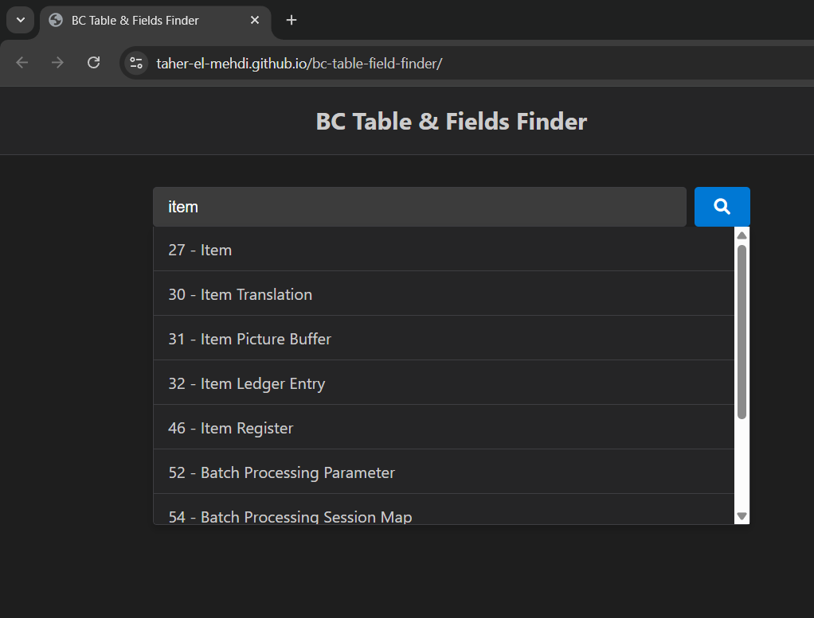
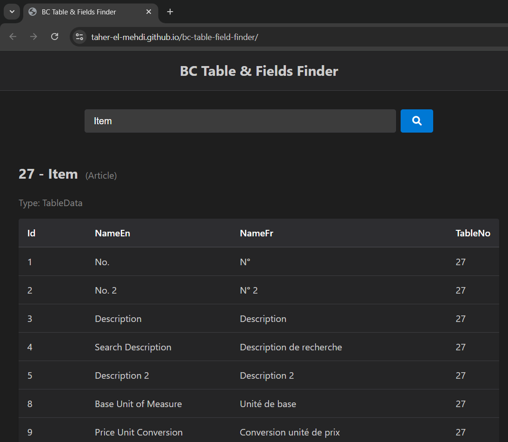

# BC Table & Fields Finder

BC Table & Fields Finder is a web-based tool designed to help Microsoft Dynamics 365 Business Central developers and functional consultants quickly find tables and fields metadata.

[**LIVE DEMO**](https://taher-el-mehdi.github.io/bc-table-field-finder/)





## 🚀 Features

- **Fast Autocomplete Search**: Instantly find tables by ID, English Name, or French Name.
- **Detailed Metadata**: View table properties and full field lists (ID, Name, Type, Length).
- **Clean Architecture**: Built with modern, modular JavaScript (ES Modules) for maintainability.
- **Responsive UI**: Dark mode interface inspired by modern development tools.
- **No Dependencies**: Pure Vanilla JS, HTML, and CSS. No build step required.

## 📂 Project Structure

The project follows a clean architecture to separate concerns:

```
/
├── index.html              # Entry point
├── src/
│   ├── main.js             # Application bootstrap and event wiring
│   ├── components/         # UI Components
│   │   ├── SuggestionList.js # Autocomplete dropdown
│   │   └── TableViewer.js    # Detailed table view
│   ├── services/           # Business Logic
│   │   ├── searchService.js  # Search indexing and filtering logic
│   │   └── domService.js     # DOM manipulation helpers
│   ├── data/
│   │   └── bc-data.js        # Business Central metadata (ES Module)
│   └── styles/
│       └── style.css         # CSS Variables and Styles
└── README.md               # Documentation
```

## 🤝 Contribution Guidelines
We welcome contributions to improve the tool!

1.  **Fork the repository**.
2.  **Create a feature branch** (`git checkout -b feature/amazing-feature`).
3.  **Follow the architecture**:
    -   Put logic in `services/`.
    -   Put UI rendering in `components/`.
    -   Keep `main.js` clean (only wiring).
4.  **Commit your changes** (`git commit -m 'Add some amazing feature'`).
5.  **Push to the branch** (`git push origin feature/amazing-feature`).
6.  **Open a Pull Request**.

## 📝 Data Source
The data is currently stored in `src/data/bc-data.js`. To update the dataset, simply replace the content of this file following the exported array structure.